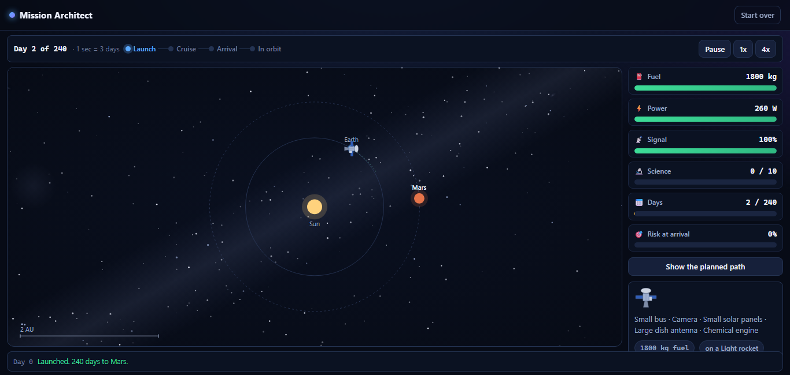
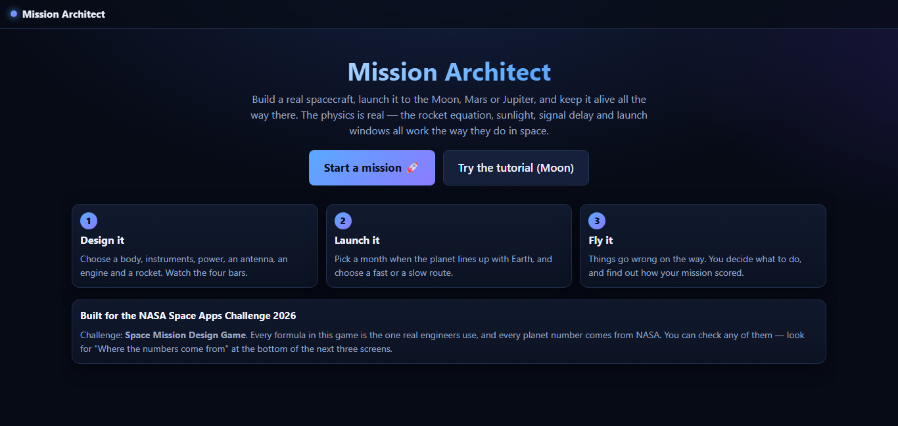
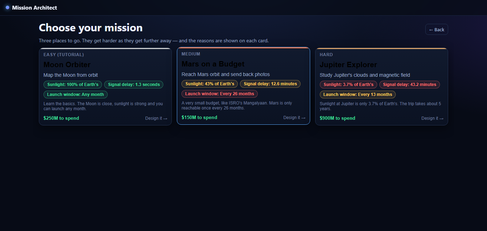
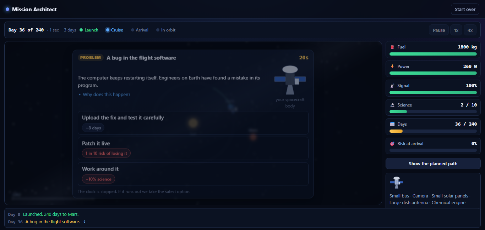
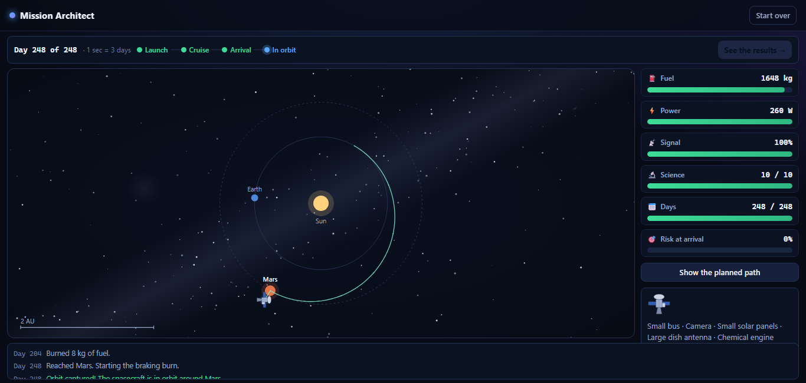
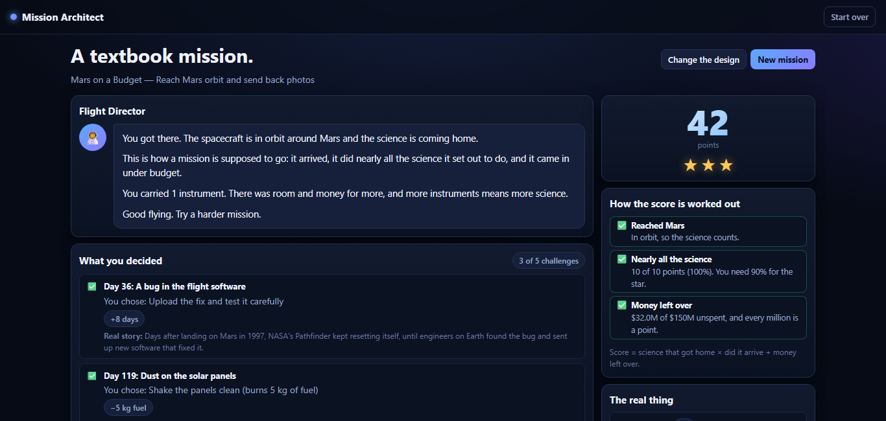
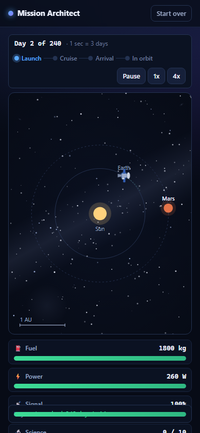

# Mission Architect

A browser game for the **NASA Space Apps Challenge 2026**, challenge *"Space Mission Design Game"*.

You pick a mission, build a spacecraft under a budget, pass five launch checks, fly it, and answer
whatever goes wrong on the way. The physics is real. The costs and the luck are tuned to be fair.



Built for students aged 12 and up. Every message on screen is written in short, plain English.

## Play it

You need [Node.js](https://nodejs.org) 18 or newer.

```bash
npm install     # one time, about a minute
npm run dev     # opens at http://localhost:5173
```

**For judges and testers:** open <http://localhost:5173/?demo=1> and press
**"Start the demo mission (Mars)"**. That one button picks Mars, loads a tested design and launches,
so you are watching a flying mission straight away. Four challenges arrive in the first minute —
including a green *opportunity* and the follow-up that choosing it causes later.

## The screens

| | |
|---|---|
| <br>**Home** — three steps, and two ways in | <br>**Choose** — each card says how hard it is, and why |
| <br>**Design Lab** — six part groups, four live bars | <br>**Launch** — the green months are real launch windows |
| <br>**A challenge** — it happens to the spacecraft *you* built | <br>**Arrival** — and the planets keep moving |
| <br>**Results** — score, stars and the Flight Director | <br>**Every number, sourced** — to NASA, or marked as ours |

It works on a phone, where every screen stacks into one column:

| | |
|---|---|
|  |  |

## The physics is real

Nothing in the flight is faked. Open **"Where the numbers come from"** on the Design Lab, Launch or
Results screen and every number is marked as a **real formula**, a **real NASA measurement**, or a
**game value we chose** — with a link to the NASA page for the first two.

- **Fuel and speed** — the Tsiolkovsky rocket equation, Δv = Isp × g₀ × ln(m₀ / mf), with
  g₀ = 9.80665 m/s². The rocket provides part of the mission Δv and the spacecraft's own engine
  finds the rest, which is how missions are really flown.
- **Power** — the inverse-square law. Mars gets about 43% of Earth's sunlight and Jupiter about
  3.7%, so the same solar panels read *600 W at the Moon* and *22 W at Jupiter*. That is why the
  nuclear battery is worth its price.
- **Signal** — light crosses one AU in 8.317 minutes, so Mars is about 12.6 minutes away each way
  and Jupiter about 43. A Moon mission is 1.3 seconds.
- **The flight path** — a Hohmann transfer, half an ellipse, with the spacecraft's position along it
  found by solving **Kepler's equation**. It really does move fast near the body it left and slowly
  at the far end. The target is placed at the true **lead angle**: it sits where it needs to be *now*
  to arrive at the meeting point at the same moment the spacecraft does.
- **Launch windows** — Mars lines up with Earth about every 26 months, Jupiter about every 13, the
  Moon needs no window at all. On the two-year calendar Mars gets one green month and Jupiter two.

See [NASA_RESOURCES.md](NASA_RESOURCES.md) for every NASA resource used and what it feeds.

## What the game does

- **Three missions** — Moon (tutorial), Mars on a Budget (Mangalyaan-style, $150M), Jupiter Explorer.
- **Six part groups** and a fuel slider, with four live bars: money, mass, power and fuel Δv.
- **Part cards that know the mission.** Each one says what choosing it would do *here*, worked out
  live from the physics — the small antenna gets 100% of your science home from the Moon and 10%
  from Mars.
- **Five launch checks** in plain English, each with a sentence saying exactly what is wrong.
- **A real launch calendar** with the window band, and a fast/slow route trade.
- **A live flight map** — seeded starfield with a Milky Way band, the orbits, the transfer, and a
  trail behind the spacecraft. A scale bar measured from the map's own AU-to-pixel factor.
- **18 challenges**, 3 to 5 per mission, drawn by chance and filtered by your design: solar storms,
  dust on the panels, course drift, lost signal, instrument faults, debris, micrometeoroids,
  sunlight pressure, planetary protection, safe mode, a busy Deep Space Network, a software bug,
  Jupiter's radiation and more.
- **Opportunities, not just problems** — a free gravity assist, an asteroid worth photographing, an
  instrument doing better than planned. Some choices cause a **follow-up later that names the day
  you made them**.
- **It happens to your spacecraft.** The sprite on the map and the drawing on the card are assembled
  from your design and sized by real numbers: the bus by mass, the panels by √watts, the dish by
  √data-rate, one box per instrument. A challenge happens to a *named part*, which is marked and
  visibly damaged — dust dulls the panels, a strike punches a hole, a fault goes dark, a lost signal
  turns the dish away. Hovering an option rings the part that option would change.
- **A two-second beat** plays over the map before each card, so the trouble is something you see
  happen. A click, Escape, a toggle or reduced motion skips it, and it costs no mission time.
- **Every challenge teaches something** — what the thing is, a real story with a year (Opportunity
  2018, Mars Odyssey 2003, New Horizons 2015, the 2021 Mars solar conjunction, Hubble 2021), how
  common it is, and coloured chips on every option saying exactly what it changes.
- **Results** — score, three stars, every decision with a ✅ or ⚠️, the whole flight log, and a
  comparison with the real missions that flew it.
- **A Flight Director** who explains what happened and the one thing most worth changing. Rule-based,
  so it works with no API key and no backend.
- **After you arrive, the planets keep moving** and the spacecraft rides the orbit it reached.
  Nothing in space stops.

## Commands

```bash
npm run dev       # dev server
npm test          # 217 tests
npm run build     # type-check + production build
npm run measure   # plays the whole game in a headless browser and checks it
```

`npm run measure` is the one worth knowing about. It plays a real mission at 1366×650 and fails if
a screen scrolls, text drops under 11px, anything hangs off the side, a challenge card hides an
option or loses keyboard focus, the mission never finishes, or the console logs an error. Run it at
another size with `npm run measure -- 390 844`. First run needs the browser: `npm run measure:setup`.

## How it is put together

```
src/data/       parts, scenarios, events, settings, realMissions, glossary, nasaSources, sky
                game.ts — the one place the JSON is read and typed
src/physics/    rocketEquation, power, comms, windows, checks, partEffects, missionFacts
src/sim/        simulation — the cruise engine; score; shipLayout; mapScale; sky; context; demo
src/store/      gameStore.ts — the only place game state lives
src/screens/    Home, ChooseMission, DesignLab, Launch, MissionControl, Result
src/components/ ResourceBars, Gauge, Spacecraft, Starfield, Beat, Timeline, Glossary, Provenance
src/styles.css  one stylesheet, plain CSS, all colour in variables on :root
```

Four rules the code sticks to:

1. **Every number lives in `src/data/*.json`**, never in a screen. Rebalancing the game is a JSON edit.
2. **Physics is pure TypeScript with no React imports**, so all of it is unit-tested.
3. **Screens are dumb** — they read the store and call its actions. Logic lives in `physics/` or `sim/`.
4. **Plain English on screen.** Short sentences. A 12-year-old should understand every message.

React 19 · TypeScript · Vite · zustand · vitest. No UI library, no backend. Animation is SVG and
`requestAnimationFrame`, and all of it is switched off by `prefers-reduced-motion`.

## Accessibility

Keyboard focus rings on every control, arrow keys through the part choices, the challenge card takes
focus when it opens, `aria-label`s on every bar and gauge, a word next to every red or green signal
so nothing depends on colour alone, and reduced motion respected throughout.

## Licence

MIT — see [LICENSE](LICENSE). Use it, change it, teach with it. The real missions, agencies and
spacecraft named in the game belong to the people who flew them; they are named here only to tell
their story.
